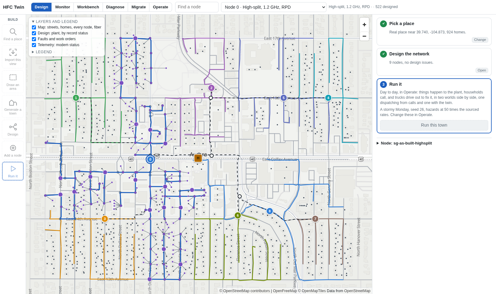
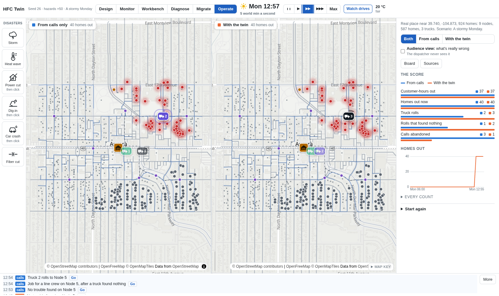
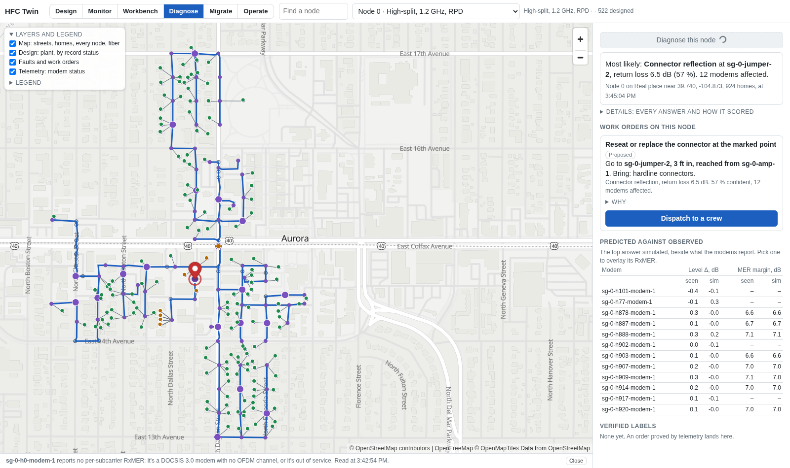
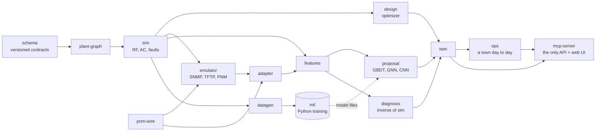

# hfc-twin

[](https://github.com/cameronsevern/hfc-twin/actions/workflows/ci.yml)
[](LICENSE)

**A physics-based digital twin of a cable (HFC) network.** One plant graph drives design, monitoring, diagnosis, work orders and
migration planning, and a deterministic RF simulation underneath turns that graph into the telemetry a real plant would report.
Diagnosis runs the simulation backwards: it asks which physical fault, at which place in the plant, best explains what the modems report.

> **Everything here is simulated.** The streets come from OpenStreetMap, but the plant on them is invented, and every fault, telemetry
> reading, phone call and truck comes from the sim. No result here has been checked against a real network.



## What it does

The whole lifecycle of one node runs on one model:

1. **Design.** Find a place and import the view, draw an area, or generate a town. The designer lays out nodes, fiber, amps, taps,
   drops and the parts inside the home, on design rules kept as data, so every node passes its level budget at −20, 20 and 45 °C.
   It gives a parts list and a cost per home, and it designs any real area without a design issue: 30 towns and twelve fresh areas.
2. **Build and monitor.** Mark it built and watch it run. Modems report DOCSIS 3.1 telemetry: RxMER per subcarrier, levels, FEC counts,
   pre-equalization and T3 and T4 timeouts.
3. **Break it.** Inject a fault as physical parameters, such as a suckout's depth and frequency, a connector's return loss, water in a
   span or LTE ingress. The sim computes what each modem sees. No fault signature is hand-written.
4. **Diagnose.** The twin ranks every component by how well a fault there explains the data, with its confidence, the runner-up and
   predicted beside observed.
5. **Fix and prove it.** It raises a work order with the fix from a policy table, dispatches it, and checks the telemetry afterward to
   confirm the fix worked.
6. **Migrate.** It compares a node before and after a move from low-split I-CCAP to high-split Remote PHY: modulation and capacity each
   way, transmit headroom, the parts that must change and the modems that lose service.
7. **Operate.** Run the town day to day. Storms, heat, dig-ins, car crashes, power cuts and fiber cuts happen as physical faults, at
   rates from published figures where there are any and generic estimates elsewhere. Households call when their own modem shows
   trouble, and trucks drive the real streets to the jobs a dispatcher sends. Two copies of the same world run side by side on one seed: one dispatched from phone calls alone, one with the twin reading
   telemetry. You can speed up the clock or drop disasters onto the map.





## What makes it different

- **One source of truth.** Every result is a pure, deterministic function of the plant graph, the profile, the component library, the
  environment, the fault set and a seed. Run it twice with the same seed and you get the same bytes.
- **Physics, not scripts.** Faults are physical parameters. Their telemetry signatures fall out of the RF model in
  [`docs/physics.md`](docs/physics.md), whose worked examples are the unit tests' oracles. The sim is checked against CableLabs'
  published measurements in [`docs/validation.md`](docs/validation.md), and the one miss is reported there.
- **Real wire formats.** A device emulator answers real SNMP and uploads real PNM files over TFTP, and the adapter reads them the way it
  would read a real modem. Connecting real gear is an integration job, not a rewrite.
- **The API is MCP.** The twin's only API is a [Model Context Protocol](https://modelcontextprotocol.io) server, and the web UI is just
  one client of it. Any agent can design, inject, diagnose and dispatch with the same tools.
- **Models judged honestly.** Each model is chosen on held-out maps by a decision rule written before any results, and test maps are
  read once. When a model misses its bar, that's reported. See [`docs/model-selection.md`](docs/model-selection.md).
- **Sourced specs.** Every component-library entry carries its source and whether it came from a datasheet or is a generic estimate.
  The reference notes in [`docs/reference/`](docs/reference/) cite the CableLabs and SCTE sections they come from.

## Quickstart

You need stable Rust. The model files are in the repo, so training isn't needed to run the twin.

```bash
cargo run --release -p mcp-server -- --http 127.0.0.1:8484 --model ml/artifacts/proposal_gbdt.json --model ml/artifacts/as_built/gbdt_maps.json
```

Each plant is asked the model trained on its kind: the first file for plant without version 2 parts, the second for plant with
premises, fittings and fiber. Leave the second out and that plant gets the no-ML answer, and says so.

Open <http://127.0.0.1:8484> and follow the three steps in the Design panel: pick a place, design the network, run it. The map loads
its library and tiles from the internet, and finding a real place uses Nominatim and Overpass. Maps and running worlds live in memory,
so a restart clears them.

To keep state in Postgres, run the same thing with Docker:

```bash
docker compose up --build
```

### From an MCP client

Run the server over stdio and point any MCP client at it. For Claude Code:

```bash
cargo build --release -p mcp-server
claude mcp add hfc-twin -- "$PWD/target/release/hfc-twin-mcp" --stdio --model "$PWD/ml/artifacts/proposal_gbdt.json" --model "$PWD/ml/artifacts/as_built/gbdt_maps.json"
```

Then ask it to design a node, inject a fault, or diagnose one. The HTTP server also answers MCP at `/mcp`. There are tools for the plant
(`get_plant`, `get_level_budget`, `get_parts_list`), design (`design_region`, `import_osm_area`, `mark_built`), faults
(`inject_fault`, `set_environment`), telemetry (`get_modem_telemetry`, `get_status_map`), work orders (`dispatch_work_order`,
`verify_work_order`), migration (`plan_migration`) and operations (`ops_start`, `ops_run`, `ops_act`, `ops_state`). Subscriber identity stays hidden unless the server starts with `--allow-identity`.

## How it's built

A Rust workspace of 14 crates. Python is used only to train models, from data files the Rust code writes, and Rust runs the result. The diagram shows how data flows between them.



| Crate | What it is |
|---|---|
| `schema` | The versioned data contracts every other crate reads, each with golden samples |
| `plant-graph` | A read-only, indexed view of a validated plant |
| `sim` | The physics: forward and return path, noise, AC power, faults, weather, and telemetry |
| `design` | Streets and homes in, a valid plant out |
| `pnm-wire`, `emulator`, `adapter` | SNMP, TFTP and PNM file formats, a sim-driven stand-in for modems and a CMTS, and the adapter that reads them |
| `features` | A pure function from observations to model features, plus the fault samplers |
| `proposal` | Rust forward passes for the trained models, checked against Python to 1e-9 |
| `diagnosis` | Topology as the prior, the sim as the likelihood, and a policy table for the fix |
| `ops` | A designed town run day to day: hazards, households that call, a call centre and trucks, from calls or with the twin |
| `twin`, `mcp-server` | The twin's operations, served over MCP on stdio and HTTP, with the map UI |
| `datagen` | Training data at scale, and the no-ML floor on the same faults |

The rules every change follows are in [`CLAUDE.md`](CLAUDE.md), and each build step has a spec in [`docs/tasks/`](docs/tasks/)
written before its code. The project is developed with [Claude Code](https://claude.com/claude-code).

```bash
cargo fmt --check && cargo clippy --workspace --all-targets -- -D warnings && cargo test --workspace --release
```

## Where it stands

All numbers below are on synthetic plant. [`docs/DESIGN.md`](docs/DESIGN.md) marks the version 1 checklist line by line.

- **Sim against published results:** every target passes except one, which misses by about 0.1 dB ([`docs/validation.md`](docs/validation.md)).
- **Finding the faulty part:** the right component is in the top 3 on 81–90 % of faults across three held-out layout families,
  beating a no-ML baseline. Calibration missed its bar of under 5 % error on all three.
- **On plant as built,** with premises, fittings and fiber: top 3 on 74 % of faults on held-out real maps, under the 80 % bar but
  16.9 points over the no-ML baseline. Fiber faults meet their bars; a fault inside one home is placed in that home only 16–20 % of the time.
- **Operating a town:** on a stormy day the twin cut customer-minutes out on 7 of 8 seed and timing variants, by 3 % to 52 %, and
  was 29 % worse on one. That's one world under one set of rates, not a measured saving.
- **Reading a whole RxMER curve:** a 120,906-weight 1-D CNN catches 99.9 % of captures with a 10 dB or worse fall, at a 0.9 % false
  alarm rate. It failed two of its ten pre-set bars, naming flat falls and sizing them, so it isn't wired in.
- **Not done:** real plant import, real CMTS adapters, realistic headend placement, and any check against a real network.

| Doc | What's in it |
|---|---|
| [`docs/DESIGN.md`](docs/DESIGN.md) | Why it exists, the architecture and the roadmap |
| [`docs/physics.md`](docs/physics.md) | The equations the sim implements, with worked examples |
| [`docs/model-selection.md`](docs/model-selection.md) | Every model result, including the failures |
| [`docs/rxmer-gallery.md`](docs/rxmer-gallery.md) | What the sim draws for each impairment CableLabs lists |
| [`docs/gallery/`](docs/gallery/) | Screenshots of the app, step by step |
| [`docs/reference/`](docs/reference/) | Notes on DOCSIS and HFC plant, with citations |
| [`docs/tasks/`](docs/tasks/) | One spec per build step |

## License

Apache-2.0. See [`LICENSE`](LICENSE).

The web UI bundles [MapLibre GL JS](https://maplibre.org), under the 3-Clause BSD license
(`crates/mcp-server/ui/vendor/MAPLIBRE-LICENSE.txt`). Map data is © OpenStreetMap contributors, under the ODbL.
