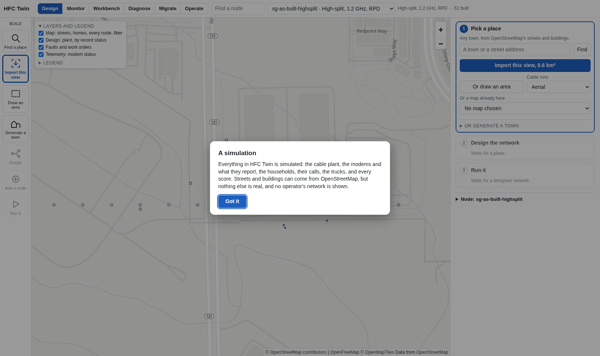
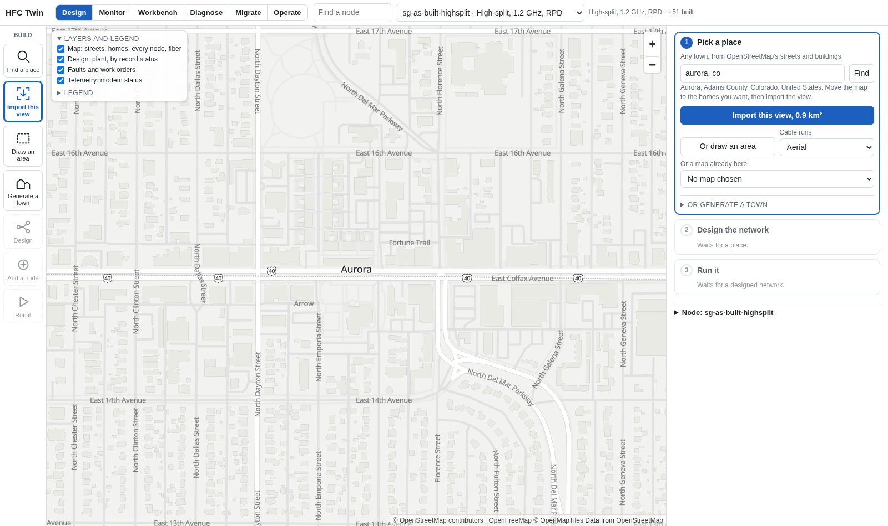
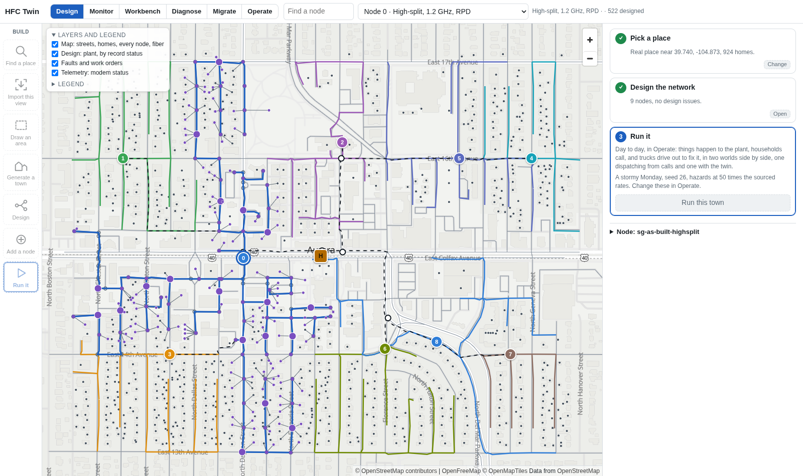
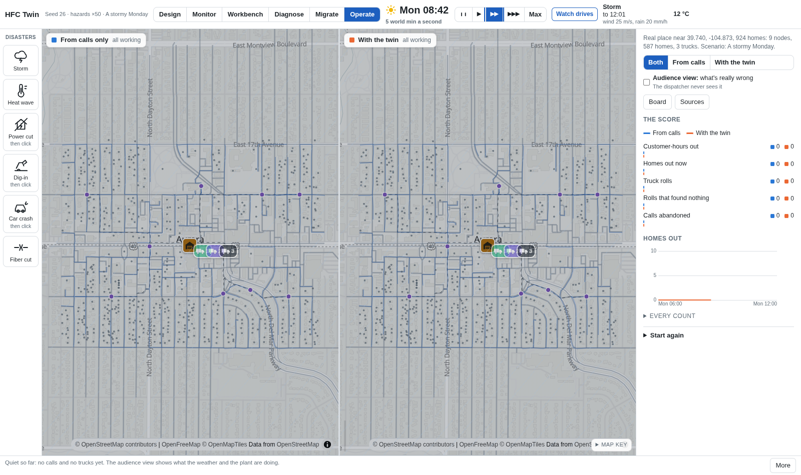

# One app (task 29)

**Real streets, synthetic plant.** Aurora, CO from OpenStreetMap (© OpenStreetMap contributors, under the Open Database License),
imported through the page, under an OpenFreeMap basemap. The plant is invented, designed by the twin on the generic rules, and every
household, call and truck is simulated. Captured in headless Chromium with software WebGL.

The page says it's a simulation once, on first load, and not again.

Step 1, picking a place. Find landed on Aurora at street level, and "Import this view" is the one primary button. The build strip
on the left marks the same next action. Steps 2 and 3 say what they wait for.

Designed: 924 homes, 0.9 km² imported in 41 s, 9 nodes with no design issues. Steps 1 and 2 show their summaries, and "Run this
town" is next.

Run it. Operate is a mode of the same page. Its clock and speed join the top bar, the disasters fill the strip, and the score fills
the panel.
