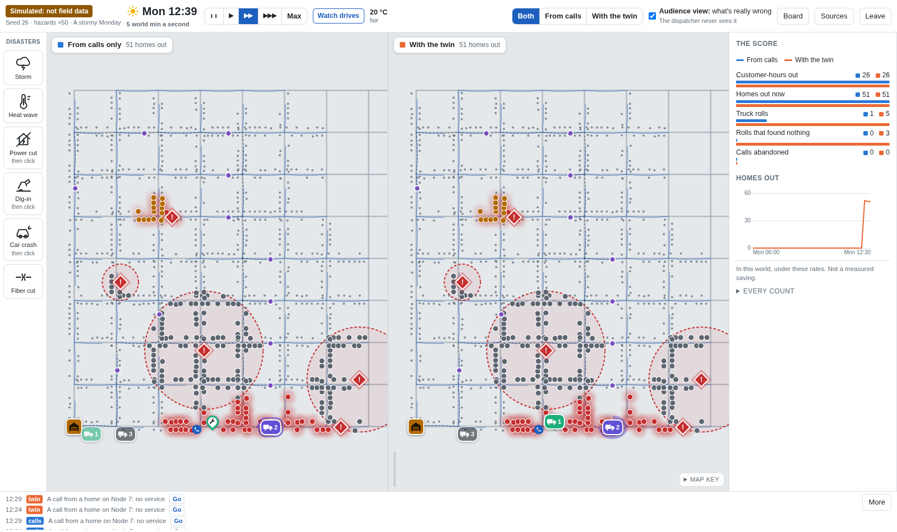
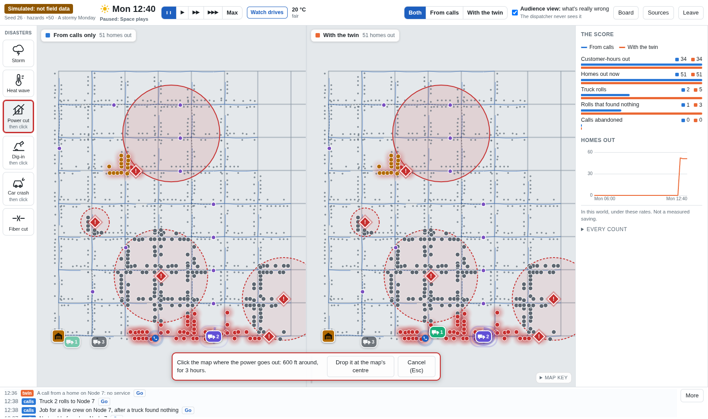
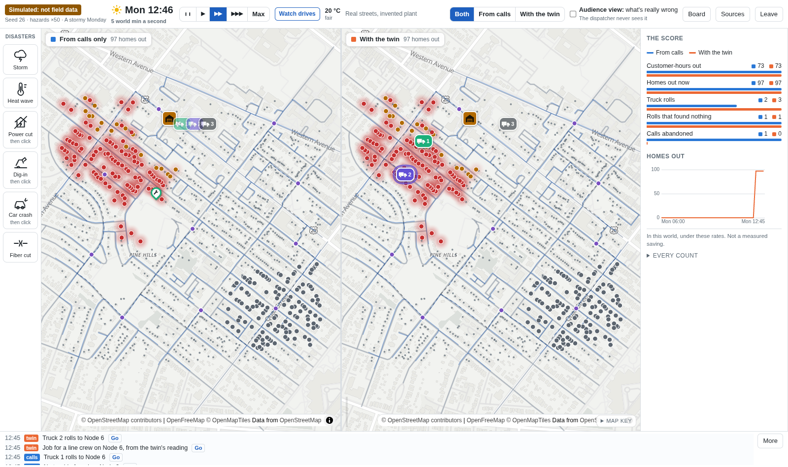

# The operations screen (task 28)

**Synthetic.** A generated town (an urban grid of about 1,600 homes, seed 1), its plant designed by the twin, run on the
"stormy Monday" scenario (seed 26, hazards at 50 times the sourced rates). Nothing here is field data. Captured in headless
Chromium with software WebGL.

12:39, just after the noon fiber cut, with the audience view on:

- From calls on the left, with the twin on the right, under the same storm aftermath.
- Dashed circles are power cuts, red diamonds are troubles.
- Homes are red when out, amber when slow, grey when they have no house power.
- Trucks are badged by crew. One is working its job, with its pulse.
- In this world, under these rates. Not a measured saving.

Placing a power cut: the tool is armed and its 600 ft circle follows the mouse in both worlds. "Drop it at the map's centre"
places it without a mouse.

**Real streets, synthetic plant.** The same scenario on a real map: a cut of Albany, NY's Pine Hills from OpenStreetMap
(`fixtures/osm/any_map/albany_center_ny.json`, © OpenStreetMap contributors, under the Open Database License), under an
OpenFreeMap basemap. The plant on it is invented, designed by the twin on the generic rules, and every household, call and truck
is simulated. 12:46, just after the noon events, audience view off.
