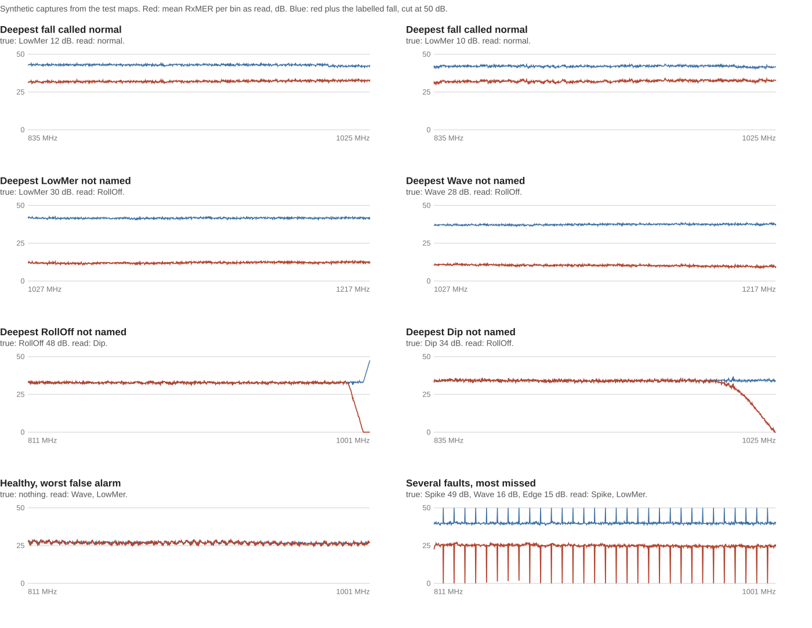

# Model selection

Six reports: step 19's reading of damage events, step 18's editing of a trained model's weights, step 24's as-built plant, step 17's RxMER curve reader, step 15's held-out maps, then step 12's held-out families. **Every number here is synthetic.** On maps the streets are real and the plant, faults and telemetry are invented. Nothing here is field data.

# Step 19: reading a hard break from which modems vanished

The question: when a cable is cut, a node fails, a strand breaks, or a neighbourhood loses power, does a no-ML reading of the modems'
states and the node's optics name where, tell a plant break from house power, and tell which way the fiber went? Reproduce it with
`datagen maps-events ml/data/events/test.jsonl ml/artifacts/as_built/maps_manifest.json ml/data/osm test 10 19`, then
`datagen events-rule` on the rows. The figures are in `ml/artifacts/events/results_events.json`, a gallery of each kind in
`docs/gallery/damage-events.md`, and the spec is `docs/tasks/19-damage-events.md`, whose bars were fixed before the test maps were read.
No model is trained or chosen here: the reading is `diagnosis::outage`, a pure function of the plant graph and one step's states.

## Verdict

**One part of three passes.** On task 15's 8 test maps, 3,300 events on version 2 designs at every node with no issue, both
fully reporting profiles, read once at 600 s:

| Part | Result | Needed | Pass |
|---|---|---|---|
| Names the break within one element (cuts, node failures, fiber cuts leaving 5 or more modems out) | 576 of 755, 76.3 % (74.0 to 78.6) | At least 90 % | **No** |
| A house-power outage leaving 5 or more modems dark, called a plant break | 44 of 293, 15.0 % (10.9 to 19.1) | At most 10 % | **No** |
| A strand broken one way read as that way | 700 of 700, 100 % | At least 95 % | Yes |

Intervals are a bootstrap over nodes. Eight strand losses that left the modems working were outside the third part, as its bar says.

**By kind, which is where the pooled share comes from:**

| Names the break | Named within one element | |
|---|---|---|
| Fiber cut | 354 of 354, 100 % | Every modem goes and the truth is the node, so this holds by construction |
| Node failure | 114 of 114, 100 % | The same |
| Span cut, open end | 87 of 113, 77.0 % (69.0 to 85.0) | The test of the reading |
| Span cut, shorted end | 21 of 174, 12.1 % (7.5 to 17.2) | The short trips its supply (§20.4), so everything it feeds goes |

## Why it misses

- **A shorted cut reads as its supply's whole run,** never the span: the modems all go together, and nothing in their states says
  where on the run the short is. How often a cut's conductors short is unsourced; the sampler draws half, so this one choice moves
  the pooled share more than anything the reading does. A supply's own alarm, which the sim doesn't emit, would place it.
- **Open cuts miss for two reasons.** A run of taps with no homes leaves several spans explaining the same modems; the reading names
  the longest, the same by-the-foot assumption the sampler draws cuts with, so it agrees with this sim by design and would only agree
  with a real one as far as cuts really fall by length. And the sim takes DOCSIS 3.0 modems off the live side of an open cut (§4.5
  keeps an SC-QAM modem's residual at its largest echo, about 15 dB down through a tap's isolation), more modems outside the point
  than the reading's tolerance allows. A real 3.0 equalizer would remove most of that echo; that's a sim finding, not changed here.
  Task 27 has since changed it (§4.5), after this run; these numbers stand for the old residual.
- **House power over the end of a street is a subtree.** Where the outage's circle takes every home on a leg and none elsewhere, the
  modems' states are what a cut there would give, and no reading of them can tell. A modem up inside the subtree rules a break out,
  which is how the other 85 % are told apart.
- **Direction is easy here:** with the optics reported, which strand is dark is read directly, and without them on an analog node the
  modems tell it too (no downstream, or downstream and no ranging), 220 of 220.

## What this doesn't show

- **Anything about real outages.** No public telemetry from a cut or a crash was found; a pass would have said the reading reads
  this sim.
- **Shares of events.** The kinds are drawn evenly, and severities from minor to total; nothing here says what's common.
- **The other kinds,** water in a device, a short on a span, a damaged tap and a utility outage reaching a supply, are in the rows
  and the gallery and not in the rule. The spectrum model's read of the survivors' curves is in each row.

# Step 18: editing the spectrum model's weights

The question: can an editor that reads step 17's spectrum model and its mistakes, and changes its weights directly, fix the part training left, without retraining and without the test maps? Reproduce it with `ml/weight_edit.py` (the commands are in its docstring; each edit is `ml/artifacts/edits/edit_NN.edit.json`). The figures are in `ml/artifacts/edits/*.score.json` and `heldout.json`, and the spec is `docs/tasks/18-weight-space-editing.md`, whose rule was amended before any edit was scored.

## Verdict

**By the rule fixed before any result, editing doesn't beat training.** The kept edit cuts the fall error by 0.17 dB on `calibrate` and by the same 0.17 dB on task 15's three reserve areas, which no model had read. But on the reserve areas it also calls 0.59 points more healthy captures not normal, past the 0.5-point noise the rule allows, so it doesn't hold. Step 17's model stays as it is.

| On the reserve areas, read once | Step 17's model | Edit 2 | Rule |
|---|---|---|---|
| Fall error, bins falling 3 dB or more | 2.177 dB | 2.007 dB | Lower by more than 0.05 dB: **yes** |
| Healthy captures called not normal, of 5,082 | 0.92 % | 1.52 % | No worse than 0.5 points: **no** |
| Fall error, bins falling less than 3 dB | 0.194 dB | 0.215 dB | No worse than 0.05 dB: yes |
| `LowMer` F1, the lowest shape | 0.686 | 0.690 | |
| Macro F1 | 0.908 | 0.908 | |
| 10 dB falls called not normal | 99.87 % | 99.93 % | |
| 20 dB falls called not normal | 100 % | 100 % | |
| Lowest median band IoU | 0.950 | 0.950 | |

7,775 captures on Greensboro, Bend and Omaha, generated at seed 5 by the same `datagen maps-spectra` that made step 17's splits; each model reads them with thresholds chosen on `calibrate`. Today's generator writes step 17's `calibrate` rows unchanged (all 18,367, schema version strings aside), so these numbers compare with step 17's test maps, where the same model had `LowMer` 0.697 and a fall error of 2.21 dB.

**On `calibrate`, where the edits were made, edit 2 meets the bars:** a fall error of 1.969 dB (bar 2.0), `LowMer` 0.706 (bar 0.70), and nothing worse than its noise, with healthy false alarms up 0.40 points. That pass is a fit to the maps it was chosen on, which is why the rule read the reserve areas too, and the false-alarm cost there came out larger.

## What the edits were

| Edit | What it changed | How its values were found | Fall error on `calibrate` | Healthy false alarms | Kept |
|---|---|---|---|---|---|
| Step 17's model | | trained | 2.138 dB | 0.85 % | |
| 1 | Eight of the mix layer's twelve units that never fire, made into one correction unit for the fall | fitted on `calibrate`'s errors | 1.954 dB | 1.84 % | No: false alarms past noise |
| 2 | The same eight units, refitted with a penalty on healthy bins read over 2.5 dB | fitted on `calibrate`'s errors | 1.969 dB | 1.25 % | Yes |

- **The fall error was the only part to fix on `calibrate`.** `LowMer` already met its bar there (0.707) and missed only on the test maps. Of its 291 misses on `calibrate`, 83 % are flat curves, and step 17 found its labels let a flat low curve be either `LowMer` or healthy, so no edit was spent on it.
- **The model under-calls falls of 3 to 10 dB.** Half the bins that fall 3 to 6 dB read under 1.5 dB (bias −1.9 dB), while bins under 3 dB read to 0.19 dB. The fall's readout is linear, so it can't lift one without the other: a scale and offset reach 2.125 dB, and a full refit of its 65 numbers reaches about 2.04 dB before the error on small bins passes the guard.
- **So the edits went inside the network.** Twelve of the mix layer's 64 units never fire on `calibrate`. Each kept edit turns eight of them into one ReLU feature, scaled by nonnegative weights chosen so the fall gains 0.83 dB per unit of it and the nine shape logits move as little as nonnegative weights allow (at most 0.22 per unit). The feature's 129 numbers were fitted on `calibrate`; the other 120,777 weights are unchanged. That is a small fit, not a choice by hand, and it's reported as one.
- **Edits chosen by hand didn't help.** On top of edit 2, a scale or offset of the fall output came out the same or worse on `calibrate`, so none was applied, and the campaign stopped at two of its 20 edits.
- **Runs:** re-applying edit 2 gives the same bytes, Rust reads it unchanged and matches Python to 1e-9 (`crates/proposal/tests/spectrum.rs`), and it has 120,906 weights. `says_dont_know` comes from step 17's separate `no_bandloss` fit, which no edit touched.

## What this doesn't show

- **Whether a different edit would hold.** One kept edit was read on the reserve areas, once. They're spent for this question, so a next attempt needs new held-out maps.
- **That editing can't beat training here.** The fall gain transferred whole; what didn't was its side effect on healthy captures, which the rule counts at 0.5 points. A unit kept away from healthy bins harder might pass, and would need maps nobody has read to show it.
- **Anything about field data.** Every capture is simulated.

# Step 24: as-built plant

The question: on plant as a field build has it (premises, fittings, plug-ins and fiber, from task 23's designer), how well do the diagnoser and its models do, and does the choice of model change? Reproduce it with `ml/run_as_built.sh` (about 25 hours on 16 threads, plus the GPU). The figures are in `ml/artifacts/as_built/results_*.json` and `sensitivity.json`, and the spec is `docs/tasks/24-as-built-diagnosis-and-selection.md`. The rules are task 15's and task 17's, unchanged, and the new bars were set before any result.

## Verdict

**The GBDT stays. By task 15's rule the GNN doesn't replace it: four parts pass and "when the sim is wrong" fails by 0.1 point.** The twin now runs this step's GBDT on plant with version 2 parts and the shipped one on plant without them. Neither model meets `docs/DESIGN.md`'s bar on this plant. Both beat the floor clearly. **Faults inside a home are almost never placed there.**

| Part of task 15's rule, on 8 test maps | GBDT | GNN | Needed | Pass |
|---|---|---|---|---|
| Top 1 through the hybrid | 60.4 % | 60.0 % | | |
| Top 3 through the hybrid | 74.0 % | 75.1 % | Difference +1.1 (95 % 0.2 to 2.1), above 0 | Yes |
| Healthy nodes called faulty | 65 of 146 (44.5 %) | 50 of 146 (34.2 %) | No more than 5 points above | Yes |
| ECE, calibrator from the `calibrate` runs | 10.5 % | 8.7 % | No more than 2 points above | Yes |
| Its lowest top 3 of the six ruled worlds (tap return loss low) | 34.0 % | 30.9 % | No more than 3 points below | **No, 3.1 below** |
| One forward pass in Rust, 81 candidates (477, the largest: 32.3 ms) | | 6.1 ms | Under 50 ms | Yes |

The top 1 difference is −0.3 (−1.5 to 0.9). Runs: 1,472 on 254 nodes, on both profiles and identical faults, with 1,251 placeable, 146 healthy and 75 upstream ingress. Intervals are a bootstrap over nodes. The miss is narrow: the difference is −3.1, and its interval (−5.6 to −0.8) reaches both sides of the −3 line. The rule is applied as written.

**`docs/DESIGN.md`'s bar**, on this plant's test maps:

| | GBDT | GNN | Needed |
|---|---|---|---|
| Top 3 through the hybrid | 74.0 % (71.5 to 76.4) | 75.1 % (72.7 to 77.5) | At least 80 % |
| Beats the floor's 57.2 % | +16.9 (14.7 to 19.1) | Yes | Yes |
| ECE | 10.5 % | 8.7 % | Under 5 % |

**The new bars:**

| Bar | Result | Needed | Pass |
|---|---|---|---|
| A fault inside a home: the top answer is a part of that home | GBDT 15.7 % (9.6 to 24.7), GNN 20.2 %, floor 18.0 %, of 89 | At least 80 % | **No** |
| A fault outside: the top answer is inside a home | GBDT 6.0 %, GNN 6.9 %, floor 13.5 %, of 1,237 | At most 10 % | Yes |
| A `FiberCut` on a cable carrying two or more nodes, named within one element | 682 of 682 (95 % from 99.4 %) | At least 90 % | Yes |
| A coax fault under one node called a fiber fault, at the region | 0 of 320 | At most 5 % | Yes |
| The same, by the node's own diagnosis | 0 of 1,101, both models | | |

The fiber's bars are on 80 generated regions of 7 to 15 nodes.

**The spectrum model passes all ten parts of task 17's rule,** on the same test maps. Step 17's failed two.

| Part of task 17's rule | Result | Needed | Pass |
|---|---|---|---|
| A 10 dB+ fall called not normal | 100 % of 5,118 | At least 99 % | Yes |
| A 20 dB+ fall called not normal | 100 % of 3,157 | At least 99.5 % | Yes |
| Healthy captures called impaired | 0.35 % of 19,910 | At most 5 % | Yes |
| Macro F1 | 0.899 | At least 0.85 | Yes |
| Lowest shape's F1 | 0.760, `Ripple` | At least 0.70 | Yes |
| Median band overlap: `Ingress`, `Dip`, `BandLoss`, `RollOff` | 1.00, 0.93, 0.99, 0.93 | At least 0.7 each | Yes |
| Mean fall error | 1.07 dB | At most 2 dB | Yes |
| `BandLoss` left out of training, its 10 dB+ captures called not normal, on `calibrate` | 100 % of 480 | At least 80 % | Yes |
| One forward pass in Rust, one thread | 26.2 ms | Under 50 ms | Yes |
| Weights | 120,906 | Under 200,000 | Yes |

F1 per shape: `Spike` 0.99, `Ingress` 0.95, `Edge` 0.92, `BandLoss` 0.91, `RollOff` 0.91, `Dip` 0.90, `LowMer` 0.89, `Wave` 0.87, `Ripple` 0.76. `LowMer` was step 17's failure at 0.70, and here it's 0.89. Why it moved so far isn't established: the plant, sim and rows all changed between the two, so the two scores don't isolate a cause. The spectrum model is still not fed to the diagnoser.

## How the numbers were made

- **Rows:** 68,440 for training, 37,280 from 29 generated designs per family and profile (half greenfield, half legacy plant upgraded in place) and 31,160 from the `train` maps, at 40 a node. 9,560 on `calibrate`. Every row is `Synthetic`, and most generated rows are over the rules' cost ceiling (built and marked), because the rural family is.
- **Choosing settings:** on the `calibrate` maps, by log loss, the same sweep size for both. The GBDT took 400 trees and 63 leaves; the GNN width 64 and 16 epochs. Calibrators came from the same maps' hybrid runs.
- **Testing:** the same 8 test maps as step 15, scored once after everything was frozen. They were scored before, for version 1 plant; this is a different plant and sim on the same streets. Step 15's three reserve areas are still unused.
- **Spectrum:** 61,629 training captures, task 17's sweep and limits, thresholds on `calibrate`.
- **The queue ran once, start to finish** (Nov 11 14:49 to Nov 12 15:35). Its last step failed for a missing latency file, which was measured afterwards on the frozen model; it reads no data.

## What changed after seeing `calibrate`

Nothing beyond what the plan does with it: the settings sweep, the calibrators and the spectrum thresholds. No setting, rule or bar was changed after a `calibrate` or test number was read.

## Where it fails

**Healthy plant.** Through the hybrid, the GBDT calls 45 % of healthy nodes faulty, and the GNN 34 %, against 7 and 9 % in step 15. The floor calls 75 %. The likely cause is what task 24 found while timing: the world draws every part within its tolerance, the floor simulates the nominal part, and a hypothesis with free parameters, mostly a sized `Misalignment` at an amp, takes up the draw. Version 2 plant offers many more of those, one at every fitted active, and the models' priors bring it down far less than in step 15. That hasn't been measured apart. The model alone calls 49 % (GBDT) and 27 % (GNN).

**Verification costs top 3 here.** The model alone reaches 80.3 % (GBDT) and 88.8 % (GNN), and the hybrid 74.0 and 75.1 %. In step 15 it cost 1.5 and 4.8 points; here 6.3 and 13.7. On this plant the sim's likelihood is pulling answers away from the right one more often than toward it. The weight between prior and likelihood still hasn't been tuned.

**By class,** top 3 through the hybrid, GBDT / GNN / floor:

| Class | Runs | GBDT | GNN | Floor |
|---|---|---|---|---|
| InHomeWiring | 89 | 22 % | 24 % | 22 % |
| OpticalTransmitterDrift | 70 | 44 % | 43 % | 6 % |
| WaterIngress | 91 | 48 % | 60 % | 31 % |
| ConnectorReflection | 79 | 49 % | 49 % | 30 % |
| FiberEventLoss | 75 | 61 % | 59 % | 8 % |
| DownstreamIngress | 92 | 71 % | 74 % | 39 % |
| Misalignment | 93 | 74 % | 77 % | 72 % |
| FrequencySelectiveLoss | 83 | 78 % | 80 % | 54 % |
| RfmMisalignment | 47 | 79 % | 79 % | 51 % |
| FiberCut | 80 | 89 % | 86 % | 61 % |
| AmpDrift | 76 | 89 % | 91 % | 91 % |
| Suckout | 93 | 95 % | 94 % | 69 % |
| BadDrop, CinLinkCut, GcpLoss, PowerSupplySag, RpdFailure, TimingLoss | 283 | 100 % | 100 % | 94 to 100 % |

- **Inside the home** is the largest miss, and the models add nothing over the floor there. The floor's own test on `one_street_as_built` puts the right part first in 23 of 32, and the right home in 26 of 32: most misses there are parts 6 to 10 ft apart, which one pre-equalizer tap can't separate. Why it's so much worse on generated plant isn't measured. One likely part: the generic rules give each home one modem, so a fault in the home moves one device, much as a bad drop does.
- **Fiber, read at the node**, is where the models help most: transmitter drift goes from 6 to 44 % and a fiber event loss from 8 to 61 %. At the region, `diagnosis::fiber` names the cable in every case. A node alone sees only its own receive side, so the region is the place to read fiber.
- **A connector at a fitting** stays near 50 % for both models.
- **Water ingress** is where the GNN gains most, as in step 15: 60 % against 48 %.

**By map and profile,** top 3 runs from 68 to 76 % for the GBDT and 70 to 79 % for the GNN, and healthy called faulty from 29 to 56 % (GBDT) and 14 to 52 % (GNN), on few healthy runs a map. High-split 75.4 / 76.4 %, low-split 71.5 / 72.8 %.

**The shipped model on this plant**, alone: top 3 64.7 %, and every healthy node called faulty. That's why each plant gets the model trained on its kind.

## When the sim is wrong

Each world moves one estimate in the plant while the diagnoser keeps the nominal value: 259 placeable faults and 34 healthy runs a world. The six are the rule's, chosen in step 15.

| World, through the hybrid | Top 3, GBDT / GNN | Top 3 difference (95 %) | Healthy called faulty, GBDT / GNN |
|---|---|---|---|
| Tap return loss low | 34.0 / 30.9 % | −3.1 (−5.6 to −0.8) | 34 / 34 of 34 |
| Tap return loss high | 69.5 / 63.3 % | −6.2 (−9.4 to −3.3) | 29 / 33 |
| Active return loss low | 40.9 / 39.0 % | −1.9 (−4.6 to 0.4) | 34 / 34 |
| Active return loss high | 69.9 / 69.1 % | −0.8 (−3.2 to 1.6) | 25 / 29 |
| Hardline and drop loss low | 66.4 / 65.6 % | −0.8 (−3.2 to 1.6) | 31 / 31 |
| Hardline and drop loss high | 61.8 / 63.3 % | +1.5 (−1.4 to 4.6) | 34 / 33 |

**Every ruled world costs both models badly, much more than in step 15.** At nominal both are at about 75 %; a 4 dB error in tap return loss takes them to a third, and a low active return loss to two-fifths. In every world 74 to 100 % of healthy nodes are called faulty. In step 15 the GNN was clearly better than the GBDT in four of these worlds; here it's clearly better in none, and clearly worse in the two tap worlds. As in step 15, the GBDT is the steadier model alone too: with tap return loss high it keeps 78 % and the GNN 50 %, and with modem implementation MER low 76 % against 48 % (`worlds_proposal_only` in the results).

Training rows still use the nominal library with each part jittered by its tolerance, so no model has seen a whole estimate off. Randomizing training across the `approx` values, as `docs/DESIGN.md` asks, is the next thing these numbers point to.

## Sensitivity: what to measure first

Step 12's report, rerun on both `one_street_as_built` nodes with the region's fiber, 40 draws a class (880 faults), the no-ML diagnoser, one estimate moved at a time. Share of answers changed, and the worst accuracy against 57.5 % at nominal:

| Estimate | From | Answers changed | Worst accuracy |
|---|---|---|---|
| Hardline and drop loss, ±10 % | step 12 | 61 % | 35.9 % |
| Active return loss, −4 to +6 dB | step 12 | 58 % | 32.1 % |
| Tap return loss, −4 to +6 dB | step 12 | 37 % | 43.9 % |
| Modem implementation MER, ±3 dB | step 12 | 27 % | 48.9 % |
| AGC range, ±3 dB | step 12 | 16 % | 53.9 % |
| Cable temperature coefficient | step 12 | 11 % | 56.5 % |
| Modem return loss | step 12 | 7 % | 55.8 % |
| CIN at reference | step 12 | 7 % | 56.4 % |
| Modem noise figure, −2 to +3 dB | task 22 | 6 % | 56.5 % |

The other eleven move under 3 % of answers, among them all of task 22's optical values (transmitter modulation index and RIN, return receiver's lowest input) and a home's coupling and the ambient level, which moved none. Those last two can't move an answer here because nothing in the fixture's homes picks up ambient without its fault; they aren't shown to be unimportant. The top three are step 12's, in a new order: hardline and drop loss moved from third to first, and every estimate moves far more answers on this plant than on version 1. **Measure hardline and drop loss, active and tap return loss, and modem implementation MER first.** Fourteen modelling choices were not moved at all; they're listed in `sensitivity.json`.

## What this doesn't show

- **Nothing about real plant.** Real streets on some maps, invented plant, simulated faults and telemetry. A score says how well a model reads this sim.
- **As-built is still our designer's build.** The plant on every map is what `design::v2` builds on generic rules, so it shares that habit with training, whatever an operator's records look like. Records that disagree with the plant aren't tested.
- **The shipped profiles report no optics and no per-port levels,** so four of the new features are empty in every scored row. On the fully loaded profiles, a read-out part of no rule, top 3 is 75.1 % (GBDT) and 75.5 % (GNN) on 265 placeable faults, much the same.
- **The legacy-then-upgraded low-split estate is barely in training,** 2,080 rows, because the designer's upgrade doesn't respace amps and leaves few clean nodes. Scored on its own, upgraded plant reads like greenfield: 74.0 against 74.0 % top 3 for the GBDT.
- **The test maps have now been read twice,** once for each version of the plant. A fit tuned on these results needs other maps.

# Step 17: reading the whole RxMER curve

The question: from one modem's OFDM capture, can a small neural network name each impairment's shape, find its band and size the fall, and say when something is wrong that it can't name? Reproduce it with `ml/run_spectra.sh`, `ml/run_spectrum_model.sh`, then `ml/evaluate_spectrum.py <data> <artifacts> test` and `ml/spectrum_readouts.py`. The figures are in `ml/artifacts/results_spectrum*.json`, and the spec is `docs/tasks/17-spectrum-model.md`.

## Verdict

**By the decision rule fixed before any result, the model is not ready. Two of the ten parts fail, both narrowly.** It catches severe damage reliably and names most shapes. It can't reliably name or size a flat fall from one capture. Nothing is wired into the twin.

| Part of the rule, on 8 test maps | Result | Needed | Pass |
|---|---|---|---|
| A 10 dB+ fall over at least 1 MHz called not normal | 99.92 % of 6,541 | At least 99 % | Yes |
| A 20 dB+ fall over at least 1 MHz called not normal | 100 % of 4,154 | At least 99.5 % | Yes |
| Healthy captures called impaired | 0.92 % of 20,679 | At most 5 % | Yes |
| Macro F1 across shapes, where a shape falls at least 3 dB | 0.901 | At least 0.85 | Yes |
| Lowest shape's F1 | **0.697, `LowMer`** | At least 0.70 | **No** |
| Median band overlap: `Ingress`, `Dip`, `BandLoss`, `RollOff` | 1.00, 0.95, 0.99, 0.93 | At least 0.7 each | Yes |
| Mean fall error on bins falling at least 3 dB | **2.21 dB** | At most 2 dB | **No** |
| `BandLoss` left out of training, its 10 dB+ captures called not normal, on `calibrate` maps | 100 % of 626 | At least 80 % | Yes |
| One forward pass in Rust, one thread | 22.3 ms | Under 50 ms | Yes |
| Rust against Python, same bytes twice, weights | Within 1e-9, same, 120,906 | 1e-9, same, under 200,000 | Yes |

F1 per shape: `Spike` 0.97, `Ingress` 0.97, `Dip` 0.94, `BandLoss` 0.93, `Ripple` 0.91, `RollOff` 0.90, `Wave` 0.90, `Edge` 0.90, `LowMer` 0.70. By map, severe captures called not normal run from 99.5 to 100 %, and healthy false alarms from 0.7 to 1.7 %. The two profiles differ by under 0.1 point on severe captures and 0.1 point on false alarms.

Published scores for this kind of model were on real data with expert labels, so they answer a different question.

## How the numbers were made

- **Data:** 17,440 training runs on the `train` maps, 4,640 on `calibrate` and 8,100 on `test`, which gave 68,741, 18,354 and 32,078 captures. 119 runs left no capture. Faults are spread from invisible to severe on purpose, so these shares say nothing about prevalence.
- **Labels:** computed by running the sim with and without each fault on one seed. The model reads a run with report scatter added.
- **Settings and thresholds:** chosen on `calibrate` maps only.
- **Test maps:** read once, after the model file was frozen. The read-outs below came after that and changed nothing.

## What changed after seeing `calibrate`

The first fit missed the rule on `calibrate`, so it was changed before the test maps were read. It's kept in `ml/data/spectra/first_fit/`.

| On `calibrate` maps | First fit | Frozen fit |
|---|---|---|
| Network | Width 48, 20 epochs | Width 64, a whole-channel summary to every bin, 40 epochs |
| Weights | 63,754 | 120,906 |
| Macro F1 | 0.813 | 0.913 |
| `LowMer` F1 | 0.634 | 0.707 |
| Lowest band overlap | 0.74 | 0.95 |
| Fall error | 2.36 dB | 2.14 dB |
| All visible shapes named, several at once | 33 % | 44 % |

So the frozen fit already missed the fall error bar on `calibrate`, and passed `LowMer` by under 0.01, which the test maps then took below the bar. I stopped there rather than keep tuning to the bar. A longer or wider fit might clear both. The sweep compared widths 48 and 64 with the summary. Width 80 without it was tried on a quarter of the data and didn't beat width 64 with it, and width 80 with it wasn't tried.

**The test maps have now been read.** Any new fit tuned on these results has to be scored on other maps. Step 15's three reserve areas are still unused.

## Where it fails

**Flat falls.** Share of captures whose shape was named, by that shape's own fall:

| Shape | 3–6 dB | 6–10 dB | 10–20 dB | 20 dB+ |
|---|---|---|---|---|
| `Spike` | 71 % | 98 % | 98 % | 99 % |
| `Ingress` | 73 % | 81 % | 97 % | 99 % |
| `BandLoss` | 71 % | 87 % | 97 % | 98 % |
| `Dip` | 64 % | 83 % | 91 % | 98 % |
| `RollOff` | 63 % | 79 % | 89 % | 95 % |
| `Wave` | 57 % | 80 % | 93 % | 99 % |
| `Edge` | 83 % | 89 % | 95 % | none |
| `Ripple` | 91 % | 75 % of 4 | none | none |
| **`LowMer`** | **4 %** | **27 %** | 92 % | 93 % |

A flat fall has no edge to read, so one capture can't show what it fell from. Under 6 dB, a `LowMer` capture usually looks like a healthy modem. On `calibrate` maps, 35 % of the 3–6 dB ones fell below the 5th percentile of healthy captures' channel means, and all of those from 10 dB up did. The channel mean alone reaches an F1 of 0.47 for `LowMer` there, so the network is doing better than that. How much of the gap could ever close from one snapshot isn't measured.

**The data adds to it.** Half of a row's modems get a 0–14 dB `BadDrop` as background, and it sits in the clean run too, so it counts as healthy. The same fault drawn as an impairment counts as `LowMer`. So a flat low curve can carry either answer. 4.4 % of healthy captures have a channel mean under 35 dB, and the lowest is 26.7 dB against a typical 40. The worst "false alarm" below is one of them. An operator would probably call that modem impaired, so the false alarm rate and the `LowMer` score are both judged against a definition of healthy that I'd now question.

**Fall size.** `LowMer` bins are 55 % of the error, at 2.93 dB, and read low by 1.88 dB on average. Without them the error is 1.69 dB. The error is highest where the fall is small: 2.67 dB at 3–6 dB and 3.73 dB at 6–10 dB, against about 1.6 dB above that. Bins read at 0 dB are about 2 % of the total, at 5.06 dB, because the sim can go lower than a curve can show.

**Several at once.** Of 555 captures with two or more visible shapes, all of them are named 45 % of the time, and 71 % of the individual shapes are. With one visible shape it's 90 %. Only 6 % of captures with a visible shape have more than one, since a row's faults usually hit different modems, so the model has seen little of this.

**Shapes that are really ambiguous.** A notch centered just past the channel edge and a roll-off draw the same curve, and the model swaps them. Some of the misses below are that, and aren't fixable from the curve. `Dip` and `RollOff` can each be either cause, which is why the model doesn't name causes.

The 30 and 28 dB panels are flat curves near 10–12 dB named `RollOff`. They were still called not normal, so the damage is caught and the name is wrong. Blue is the red curve plus the labelled fall, so it overshoots where the sim fell below 0 dB.

**Don't know.** 6.4 % of test captures got a "don't know". The bar's test is one left-out shape on one set of maps, so it doesn't show how the model treats a kind of damage nobody put in the sim.

## The one real capture

Through the Rust path, the one public capture in `fixtures/field/` reads as one `Spike`, 749.9–750.1 MHz, with an estimated fall of 10 dB and nothing else. That matches what's visible: mostly healthy with a spike at 750 MHz. It's one file of unverified origin, so it's a sanity check and not a score.

## The step 15 models at field-sized faults

Before step 16 changed the sim, step 15's models were run alone on `calibrate` maps with one thing off by far more than a tolerance. These are a separate experiment on the old sim, so they don't compare directly with the numbers above. Each cell is top 3 / share of healthy runs called faulty, in %. `relative` reads each modem relative to its node's median. `varied` trains on worlds with whole estimates moved. `varied_blind` is the same, with modem MER and tap return loss never moved in training.

| World | GNN, `relative` | GNN, `varied` | GNN, `varied_blind` | GBDT, `varied` |
|---|---|---|---|---|
| Nominal | 92 / 3 | 92 / 3 | 92 / 4 | 87 / 1 |
| Modem MER, low | 91 / 6 | 91 / 2 | 89 / 8 | 84 / 1 |
| Modem MER, high | 91 / 14 | 91 / 3 | 90 / 9 | 84 / 1 |
| Tap return loss, low | 79 / 98 | 86 / 13 | 80 / 76 | 80 / 15 |
| Tap return loss, high | 76 / 97 | 88 / 5 | 87 / 20 | 82 / 2 |
| CIN, low | 83 / 84 | 91 / 8 | 90 / 12 | 84 / 1 |
| Estimates varied | 79 / 94 | 87 / 9 | 86 / 28 | 81 / 8 |
| Modem MER −10 dB | 78 / 46 | 32 / 100 | 26 / 85 | 70 / 100 |
| Modem MER −20 dB | 56 / 86 | 23 / 100 | 22 / 49 | 50 / 100 |
| Taps at 7 dB return loss | 50 / 100 | 45 / 100 | 42 / 100 | 55 / 100 |
| Cable loss +30 % | 70 / 98 | 70 / 46 | 73 / 26 | 60 / 100 |
| Severe faults | 93 / 3 | 92 / 2 | 93 / 2 | 88 / 1 |

Training on varied worlds fixed the moderate ones and did nothing past them. At 10 or 20 dB off, every model either flags everything or loses the fault. `relative_medians` and `varied_relative` were lost in a restart and not rerun, since the sim had changed. None of this has been rerun on the current sim, so step 15's choice of GNN still rests on the old one.

## What this doesn't show

- **Nothing about real plant.** The streets are real, and the plant, faults and telemetry are simulated. A score says how well the model reads this sim. No labelled real data is public, and proprietary data isn't an option.
- **A snapshot, not a history.** Rows take one step, so a modem going up and down gives a curve only when it's up, and a modem that's gone gives none. That's a different problem, and physical breaks will need it.
- **Shape, not cause.** Nothing here is fed to the GNN or the verifier yet.
- **Not every impairment.** Hum, histogram clipping, constellation compression and second-order correlation aren't reproduced by the sim, so the model has never seen them.
- **The share of severe damage in this data is a choice,** not a measurement.

# Step 15: held-out maps

The question: on profiles it trained on, how does the model do on streets it has never seen? Reproduce it with `ml/run_maps.sh` (about 10 hours on 16 threads). The figures are in `ml/artifacts/results_maps*.json`, and the spec is `docs/tasks/15-held-out-maps-selection.md`.

## Verdict

**By the decision rule fixed before any result, the GNN replaces the GBDT. All five parts pass.** The twin still runs the shipped GBDT, since wiring the GNN in is a separate step.

**One finding came after the rule and doesn't change it, but it should come before wiring:** with one estimate wrong by 3 dB, the GNN loses clearly to the GBDT (see "When the sim is wrong").

| Part of the rule, on 8 test maps | GBDT | GNN | Needed | Pass |
|---|---|---|---|---|
| Top 1 through the hybrid | 75.4 % | 78.5 % | | |
| Top 3 through the hybrid | 86.4 % | 89.6 % | Difference +3.2 (95 % 2.1 to 4.3), above 0 | Yes |
| Healthy nodes called faulty | 13 of 182 (7.1 %) | 16 of 182 (8.8 %) | No more than 5 points above | Yes |
| ECE, calibrator from the `calibrate` runs | 2.2 % | 1.6 % | No more than 2 points above | Yes |
| Its lowest top 3 of the six ruled worlds | 51.6 % | 56.9 % | No more than 3 points below | Yes |
| One forward pass in Rust, 109 candidates | | 6.0 ms | Under 50 ms | Yes |

The top 1 difference is +3.2 (1.7 to 4.7). Runs: 1,652 on 402 nodes, on both profiles and identical faults, with 1,351 placeable, 182 healthy and 119 upstream ingress. Intervals are a bootstrap over nodes.

**This isn't the bar in `docs/DESIGN.md`.** The bar asks about held-out families and step 12's verdict below stands, with calibration missed. The GNN hasn't been through the hybrid on a held-out family, and an ECE of 1.6 % here is not a pass of that bar. These are unseen streets on plant the sim designed the same way as training, so this test is easier in exactly the way that flatters calibration.

## How the numbers were made

- **Training:** 67,600 rows, 12 times step 12's: 60 generated designs per family and profile, plus 13 real maps on both profiles, at 40 rows per node.
- **Choosing settings:** 4 other maps, by log loss, the same sweep size for both. The GNN took width 64 and 16 epochs, the GBDT 400 trees and 31 leaves. Calibrators came from the same 4 maps.
- **Testing:** 8 maps in other metros, scored once after all that was frozen. Three reserve test areas were never used, so no model has seen them. (Step 18 later read them once, for the spectrum model only.)

## What the win is made of

| Top 3 | GBDT | GNN |
|---|---|---|
| Through the hybrid | 86.4 % | 89.6 % |
| The model alone | 87.9 % | 94.4 % |
| Top 1, the model alone | 70.9 % | 82.5 % |
| Healthy called faulty, the model alone | 1.1 % | 4.4 % |
| No-ML floor | 68.8 %, 125 of 182 healthy called faulty | |

- **Most of it is one class.** The GNN gets 43 more placeable faults into its top 3, net. Water ingress is 29 of those, going from 48 % to 67 %. Everything else together is about 1 point.
- **It holds across maps.** Top 1 is higher on all 8, and top 3 is higher on 7 and tied on the smallest. Without Lexington, the largest, top 3 is still +3.4.
- **It shows on real streets, not generated ones.** On fresh generated layouts, top 3 ties at 91.1 %, and top 1 is +2.4 (0.0 to 4.7). ECE is 2.1 % for the GBDT and 2.8 % for the GNN. Healthy nodes called faulty are 14.0 % for both.
- **Verification costs the GNN accuracy when the sim is right.** Alone it scores 94.4 %, and through the hybrid 89.6 %, and its false alarms double. That isn't a reason to drop verification, as the next section shows, but the weight between the prior and the sim's likelihood hasn't been tuned for this model.
- **More data helped the GBDT too.** Against the shipped GBDT, alone on the same faults, it gained 4.7 points of top 1 and 3.1 of top 3 (66.2 / 84.8 % to 70.9 / 87.9 %).

| Class | Runs | Top 3, GBDT | Top 3, GNN | Top 3, floor |
|---|---|---|---|---|
| WaterIngress | 155 | 48 % | 67 % | 17 % |
| DownstreamIngress | 147 | 73 % | 74 % | 35 % |
| RfmMisalignment | 42 | 76 % | 79 % | 74 % |
| ConnectorReflection | 130 | 86 % | 92 % | 52 % |
| FrequencySelectiveLoss | 154 | 86 % | 87 % | 60 % |
| Suckout | 132 | 90 % | 91 % | 64 % |
| PowerSupplySag | 152 | 99 % | 99 % | 99 % |
| AmpDrift, BadDrop, CinLinkCut, GcpLoss, RpdFailure, TimingLoss | 439 | 100 % | 100 % | 92 to 100 % |

| Map | Placeable | Top 1, GBDT / GNN | Top 3, GBDT / GNN | Healthy called faulty, GBDT / GNN |
|---|---|---|---|---|
| lexington_ky | 448 | 75.9 / 79.5 % | 87.5 / 90.2 % | 5.0 / 3.3 % |
| albany_ny | 223 | 72.6 / 75.3 % | 80.3 / 85.2 % | 18.5 / 18.5 % |
| culver_city_ca | 214 | 76.6 / 81.3 % | 86.4 / 90.7 % | 3.3 / 6.7 % |
| albuquerque_nm | 205 | 79.0 / 81.0 % | 89.3 / 91.7 % | 11.8 / 14.7 % |
| keene_nh | 97 | 71.1 / 74.2 % | 82.5 / 84.5 % | 0.0 / 6.7 % |
| lakewood_oh | 97 | 74.2 / 76.3 % | 89.7 / 92.8 % | 0.0 / 7.1 % |
| wauwatosa_wi | 55 | 72.7 / 74.5 % | 92.7 / 94.5 % | 0.0 / 0.0 % |
| alamo_heights_tx | 12 | 75.0 / 83.3 % | 83.3 / 83.3 % | 0.0 / 0.0 % |

The healthy columns rest on few runs per map. Lexington has about a third of the test, and Alamo Heights is too small to read alone.

## When the sim is wrong

Each world moves one estimate in the plant while the diagnoser keeps the nominal value, on the test maps: 283 placeable faults and 38 healthy runs per world. Every world here is a guess at how the sim could be wrong, and a real plant could be wrong in all of them at once.

The first six are the rule's, chosen before any result from the estimates that moved the no-ML diagnoser most. **The last three were added after seeing the result**, because they hurt the GNN most on its own. They're a read-out and not part of the rule.

| World, through the hybrid | Top 3, GBDT / GNN | Top 3 difference (95 %) | Top 1 difference (95 %) | Healthy called faulty, GBDT / GNN |
|---|---|---|---|---|
| Tap return loss low | 51.6 / 56.9 % | +5.3 (2.5 to 8.2) | +4.6 (1.9 to 7.5) | 38 / 38 of 38 |
| Tap return loss high | 74.2 / 72.1 % | −2.1 (−5.0 to 0.7) | −6.0 (−9.6 to −2.5) | 19 / 23 |
| Active return loss low | 70.7 / 76.7 % | +6.0 (2.5 to 9.7) | +4.6 (1.7 to 7.8) | 38 / 38 |
| Active return loss high | 77.7 / 78.1 % | +0.4 (−1.7 to 2.5) | −1.8 (−5.1 to 1.7) | 11 / 22 |
| Hardline and drop loss low | 77.7 / 83.0 % | +5.3 (2.4 to 8.2) | +2.1 (−0.4 to 4.8) | 13 / 10 |
| Hardline and drop loss high | 76.7 / 82.7 % | +6.0 (3.4 to 8.9) | +4.2 (1.4 to 7.3) | 34 / 34 |
| Added: modem implementation MER low | **80.2 / 68.2 %** | **−12.0 (−16.1 to −8.3)** | −8.5 (−12.4 to −4.9) | 25 / 22 |
| Added: modem implementation MER high | 80.6 / 80.6 % | 0.0 (−2.8 to 3.0) | +4.2 (1.1 to 7.5) | **4 / 37** |
| Added: CIN at reference low | 77.4 / 76.7 % | −0.7 (−3.5 to 2.1) | +2.1 (−1.1 to 5.5) | 30 / 36 |

**A 3 dB error in modem implementation MER costs the GNN 12 points of top 3 against the GBDT in one direction, and in the other it calls 37 of 38 healthy nodes faulty, against the GBDT's 4.** The rule as written doesn't see this, and wouldn't even with these worlds added: it compares models only at the GNN's own lowest world, which is still tap return loss low. That was a gap in the rule, and it's reported here rather than changed afterwards.

The model alone shows why. Its top 3 and healthy false alarm rate, at the ends where they part most:

| Model alone, GBDT / GNN | Top 3 | Healthy called faulty |
|---|---|---|
| At nominal | 87.9 / 94.4 % | 1.1 / 4.4 % |
| Modem implementation MER low | 79.6 / 36.0 % | 98 / 100 % |
| Modem implementation MER high | 86.9 / 83.5 % | 11 / 95 % |
| Tap return loss high | 80.8 / 46.0 % | 5 / 100 % |
| Active return loss high | 82.2 / 75.2 % | 4 / 97 % |
| Modem return loss high | 84.9 / 90.5 % | 4 / 72 % |
| Hardline and drop loss high | 83.2 / 90.8 % | 58 / 25 % |

The GNN is better where the world matches its training and much less stable where it doesn't. Verification rescues most of that, not all. Training rows use the nominal library with each part jittered by its tolerance, so neither model has ever seen a whole estimate off. `docs/DESIGN.md` says training should randomize across the uncertainty in the `approx` values, and it doesn't yet. Why the GNN moves more isn't established: the likely reason is that its raw inputs carry absolute levels, but that hasn't been tested.

Measure modem implementation MER early, alongside the three step 12 named, since the sensitivity report's no-ML diagnoser didn't rank it highly.

## Data and settings

On the `calibrate` maps, the model alone, at each one's default settings:

| Training layouts | GNN top 1 / top 3 / log loss | GBDT top 1 / top 3 / log loss |
|---|---|---|
| 24 | 75.3 / 88.7 % / 0.81 | 68.9 / 85.0 % / 0.98 |
| 48 | 77.7 / 89.9 % / 0.70 | 70.0 / 85.4 % / 0.94 |
| 96 | 79.7 / 90.8 % / 0.65 | 70.7 / 85.8 % / 0.93 |
| 193 | 81.3 / 92.1 % / 0.55 | 72.3 / 87.2 % / 0.85 |

Both are still rising, so a final model should train on more. The GNN's curve also mixes in gradient steps, since fewer rows at the same epochs means fewer steps.

## Stress tests

The model alone, on generated layouts, with the settings above. Top 1 / top 3 / healthy called faulty / ECE:

| Held out | GBDT | GNN |
|---|---|---|
| UrbanGrid | 72.2 / 86.3 / 2.1 / 5.2 % | 82.2 / 91.4 / 7.0 / 2.6 % |
| Suburban | 74.7 / 90.6 / 0.0 / 2.8 % | 83.9 / 94.7 / 7.6 / 3.3 % |
| Rural | 54.7 / 76.0 / 34.8 / 8.5 % | 65.5 / 81.4 / 32.5 / 13.1 % |
| Low-split profile | 59.5 / 84.4 / 1.0 / 5.6 % | 65.4 / 84.5 / 20.2 / 5.8 % |
| High-split profile | 63.8 / 85.2 / 2.7 / 4.3 % | 67.1 / 84.8 / 47.8 / 10.6 % |

With 12 times the data, the GNN no longer falls apart on a profile it hasn't seen: high-split false alarms are 48 %, not 100 %. That's still far from usable, so a new profile has to be trained on before it goes live, as this step assumes.

## What this doesn't show

- **Nothing about real plant.** Real streets don't make a real network. Training and test share the sim, and the sections above show how far an error in it can move the answer.
- **The plant on these maps is what our optimizer designs,** so it shares that habit with the training maps, whatever the operator's plant looks like.
- **OSM isn't a random sample.** The areas were chosen by hand for variety, and mapped homes undercount apartment buildings.
- **Time and market splits** wait for field data, because rows have no real time.

# Step 12: held-out families

Reproduce it with `ml/run_all.sh` (a bit over two hours on 16 threads). The figures are in `ml/artifacts/`.

## Verdict against the bar

The bar (`docs/DESIGN.md`): on held-out layout families, the faulty component in the top 3 at least 80 % of the time, beating the no-ML floor, with calibration error under 5 %.

| Held-out family | Top 3 with the model (95 %) | Floor top 3 (95 %) | At least 80 %? | Beats floor? | ECE | Under 5 %? |
|---|---|---|---|---|---|---|
| UrbanGrid | 85.2 % (79.3–89.6) | 62.1 % (54.9–68.8) | Yes, interval reaches below | Yes | 5.4 % | **No** |
| Suburban | 89.6 % (84.4–93.3) | 67.2 % (60.1–73.6) | Yes | Yes | 7.5 % | **No** |
| Rural | 80.9 % (75.8–85.2) | 68.5 % (62.7–73.8) | Yes, interval reaches below | Yes | 8.1 % | **No** |

**Localization passes. Calibration misses on all three families.** It was reported rather than tuned, as the spec says. Rural's top 3 sits right on the line: its interval doesn't exclude a true rate under 80 %.

The proposal model picked is the **GBDT on hand features**, shipped as `ml/artifacts/proposal_gbdt.json`.

## How the final numbers were made

- The GBDT for each family trained only on the other two families, at seed 1.
- The calibrator for each family was fitted on the other two families' hybrid runs, at seed 1.
- Scoring ran once, at seed 2, on layouts neither had seen: 771 runs, half on each profile, 632 with a placeable fault, 81 healthy and 58 upstream ingress. Upstream ingress can't be placed on a span, so it counts toward ECE but not top 3.
- Top 3 counts distinct components, since one component tried as two causes is one place to send a truck.
- Both diagnosers ran on the same faults, so floor and model are compared on identical rows.

## With the model and without

| | UrbanGrid | Suburban | Rural |
|---|---|---|---|
| Top 1, model | 73.1 % | 81.4 % | 66.3 % |
| Top 1, floor | 59.9 % | 61.7 % | 57.3 % |
| Healthy node named as faulty, model | 7 of 26 | 0 of 17 | 3 of 38 |
| Healthy node named as faulty, floor | 23 of 26 | 12 of 17 | 17 of 38 |
| ECE, model, raw posterior | 17.4 % | 8.6 % | 17.0 % |
| ECE, floor, raw posterior | 31.8 % | 22.1 % | 23.4 % |
| Simulations per diagnosis, model | 123 | 127 | 122 |
| Simulations per diagnosis, floor | 105 | 106 | 101 |

Pooled, the top 3 is 84.7 % against the floor's 66.3 % (535 and 419 of 632).

The model costs simulations here rather than saving them. Its proposals are tried beside the topology's candidates, and the first version, which tried them instead, was cheaper and worse (see below).

**False alarms remain a real weakness:** 27 % on UrbanGrid. The floor's are worse, and on these plants its raw posterior isn't usable as a confidence.

### By fault class, all three families pooled

| Class | Runs | Top 3, model | Top 3, floor |
|---|---|---|---|
| WaterIngress | 57 | 39 % | 25 % |
| DownstreamIngress | 77 | 61 % | 34 % |
| RfmMisalignment | 25 | 80 % | 76 % |
| FrequencySelectiveLoss | 65 | 83 % | 51 % |
| Suckout | 67 | 85 % | 45 % |
| ConnectorReflection | 62 | 90 % | 40 % |
| AmpDrift | 72 | 100 % | 99 % |
| BadDrop | 56 | 100 % | 89 % |
| CinLinkCut | 30 | 100 % | 100 % |
| GcpLoss | 20 | 100 % | 100 % |
| PowerSupplySag | 70 | 100 % | 100 % |
| RpdFailure | 16 | 100 % | 100 % |
| TimingLoss | 15 | 100 % | 100 % |

The model's gain is on the RF faults that leave a shape. Faults with one obvious place were already easy.

Water is the worst class. Of its 35 misses, 25 answered "healthy". Sections with under 1 dB of added loss at nominal `k` were found 4 times in 22, and larger ones 18 in 35. Some of these draws may simply be too small to see through the noise, but that hasn't been established, and they count as misses here.

## The calibration miss

Each read-out below comes from `ml/evaluate_hybrid.py`. "If calibrated" is the ECE of outcomes drawn from these same confidences, so calibrated by construction. It shows what this few runs would read anyway.

| Held-out family | Top answer right | Mean confidence | ECE (bootstrap 95 %) | If calibrated: mean, 95th percentile |
|---|---|---|---|---|
| UrbanGrid | 71.3 % | 70.1 % | 5.4 % (4.1–9.9) | 4.7 %, 6.7 % |
| Suburban | 82.2 % | 76.2 % | 7.5 % (5.6–11.6) | 5.1 %, 7.3 % |
| Rural | 67.9 % | 75.3 % | 8.1 % (5.6–12.5) | 4.3 %, 6.2 % |

Two things follow, and neither changes the verdict:

1. **The miss is real on Suburban and Rural.** Both are past what noise would show. Rural is overconfident by 7 points and Suburban underconfident by 6, so a calibrator fitted on some families doesn't transfer to another. UrbanGrid can't be told apart from calibrated.
2. **This test can barely resolve the bar.** A perfectly calibrated model would read 4.3–5.1 % at these row counts. Judging 5 % fairly needs a few times more runs per family, or a debiased estimator.

The shipped calibrator, fitted on all three families, reads 1.8 % across all the seed-2 layouts. That is not the bar: those are unseen layouts of families it saw, and pooling lets the family offsets cancel. It does mean the page's number is reasonable on ground like its training data and shouldn't be trusted on a new kind of plant. That combination also used the hold-out GBDTs, not the shipped one, which has no unseen family left to score on.

## Candidates

Proposal only, before the sim verifies anything, held out as named:

| Held out | GBDT top 1 / top 3 | GBDT false alarm / ECE | GNN top 1 / top 3 | GNN false alarm / ECE |
|---|---|---|---|---|
| UrbanGrid | 69.0 / 83.1 % | 17.8 / 5.7 % | 76.2 / 88.3 % | 7.9 / 3.6 % |
| Suburban | 69.8 / 89.2 % | 0.0 / 3.8 % | 76.6 / 92.1 % | 0.0 / 1.9 % |
| Rural | 55.2 / 80.8 % | 11.1 / 6.0 % | 61.6 / 81.9 % | 9.4 / 7.2 % |
| Low-split profile | 55.6 / 82.4 % | 0.4 / 6.3 % | 55.5 / 76.9 % | 0.4 / 9.4 % |
| High-split profile | 61.2 / 84.8 % | 3.6 / 4.7 % | 52.0 / 78.3 % | 100 / 13.8 % |

**The choice is not a clean win.** The GNN is better on all three family hold-outs, by 1 to 5 points of top 3. The GBDT was chosen because:

- The GNN falls apart on a profile it hasn't seen, including calling every healthy node faulty when high-split is held out. This report called a rollout to high-split exactly that shift. That reasoning was wrong: the sim can train on a profile before that equipment goes live, so a rollout doesn't face it. Step 15 reopened the choice for that reason.
- The GBDT runs in-process from Rust today, and its scores match Python's on the parity file. The GNN has no Rust forward pass.

The second reason means **the GNN was never run in the hybrid**, so its family advantage might have carried through. Step 15 wrote the forward pass, and ran the hybrid on held-out maps, not families.

**Latency.** One GBDT pass, rows included, takes 9 ms on a node with 109 candidate places (`crates/datagen/examples/proposal_latency.rs`). The GNN takes 0.6–0.9 ms per group in Python, excluding row building. Neither matters beside the verification: on the live twin one `diagnose` takes about 13 s at this size, running both the floor and the model.

**Not built:** GBDT on encoder embeddings and the GNN with a temporal layer. The spec keeps them for when these two can't meet the bar, and strictly that's now the case. Better localization wouldn't obviously fix a calibrator that doesn't transfer, so these wait on a decision.

**Not measured, though `docs/DESIGN.md` lists them:** parameter error, compound-fault recall (every row has one fault), and hold-outs by density, cascade depth and aerial versus underground, beyond what the three families vary. The hybrid wasn't run on the profile hold-outs either, so those rows above are proposal only.

## What changed after seeing earlier numbers

The final run is not a first attempt, and these figures should be read with that in mind. The first run, on plants later found to be wrong:

| Held out | GBDT top 1 / top 3 / ECE | GNN top 1 / top 3 / ECE | Floor top 1 / top 3 / ECE |
|---|---|---|---|
| UrbanGrid | 70.7 / 94.3 / 2.7 % | 75.7 / 94.4 / 3.1 % | 77.6 / 80.5 / 18.2 % |
| Suburban | 70.9 / 94.2 / 1.9 % | 77.6 / 96.0 / 1.7 % | 70.0 / 77.9 / 21.6 % |
| Rural | 52.4 / 80.0 / 8.3 % | 60.7 / 83.1 / 7.6 % | 60.8 / 72.4 / 21.3 % |

The first hybrid, on Rural only, missed the bar: top 1 61.6 %, top 3 74.4 %, ECE 27 %, 42 simulations against the floor's 84. These are in `ml/artifacts/first_run/`.

Changes made after that, each for a stated reason:

- **Transient faults were read after they had ended.** Reading time was uniform over a day, so most RPD transients were labelled but invisible. Rows now read while the fault lasts.
- **The hybrid threw away everything outside the model's top 5 and skipped quiet nodes.** Proposals are now tried beside all the topology's candidates, as a prior on one scale.
- **The raw posterior is overconfident.** A logistic calibration of "the top answer is right" was added, over five features of the answer.
- **The plant generator silently lost homes.** Streets crossed with no shared point, so homes off the root's piece of the graph vanished while still counted as passed: 1,158 modems on 4,108 homes at full take. This was a step 8 bug, found by noticing 3–15 modems per node. Fixed, and everything was regenerated. That's the likely reason the proposal numbers fell from the first run's, since nodes now hold far more modems.
- **Denser plants exposed two more problems.** SC-QAM ISI summed 50+ small echoes and took healthy D3.0 modems offline, so it now uses the largest echo, an approximation noted in `docs/physics.md` §4.5. Bad-drop candidates were limited to 3 affected modems, and now scale with node size.

None of them looked at seed 2, which was scored once. After it, only read-outs were added and the headline numbers were checked as unchanged. The work-order gate in step 13 also came after it, and doesn't touch what's scored.

## Sensitivity: what to measure first

Each estimate is moved in the world at both ends of its range while the diagnoser keeps the nominal value, on 360 synthetic faults. Accuracy at nominal is 78.4 %.

| Estimate | Range | Answer changed | Worst accuracy |
|---|---|---|---|
| Tap return loss | −4 to +6 dB | 25.1 % | 63.8 % |
| Active return loss | −4 to +6 dB | 19.4 % | 69.1 % |
| Hardline and drop loss | ±10 % | 18.1 % | 74.4 % |
| AGC range | ±3 dB | 9.7 % | 74.1 % |
| Modem implementation MER | ±3 dB | 7.4 % | 79.1 % |
| Cable temperature coefficient | ±0.0005 per °C | 5.4 % | 79.1 % |
| Modem return loss | −4 to +6 dB | 5.0 % | 76.9 % |
| CIN at reference | −10 to +4 dB | 4.4 % | 77.8 % |
| Tap port isolation | ±6 dB | 4.0 % | 77.5 % |
| Forward noise figure | −2 to +3 dB | 0.3 % | 78.8 % |
| Active power draw | −60 to +20 % | 0.1 % | 78.1 % |
| Loop resistance | −10 to +25 % | 0.0 % | 78.4 % |
| Return noise figure | −4 to +2 dB | 0.0 % | 78.4 % |

**Measure outdoor tap return loss first, then active return loss, then hardline and drop loss.** A real sweep of a few parts would remove the largest sensitivity found here.

The limits: this ran the no-ML diagnoser, one estimate at a time, on the one-street fixture at high-split, not on a region. Estimates that grow with plant length, such as loop resistance and the `r_loop` temperature effect step 3 deferred, are probably understated on a street this short.

## What this doesn't show

Nothing here says how the model does on a real plant. It says the model generalizes across layouts the sim can generate. Training and test share the sim, so any error the sim makes is invisible to all of these numbers. `docs/DESIGN.md` makes the first real plant the final held-out set for that reason.
