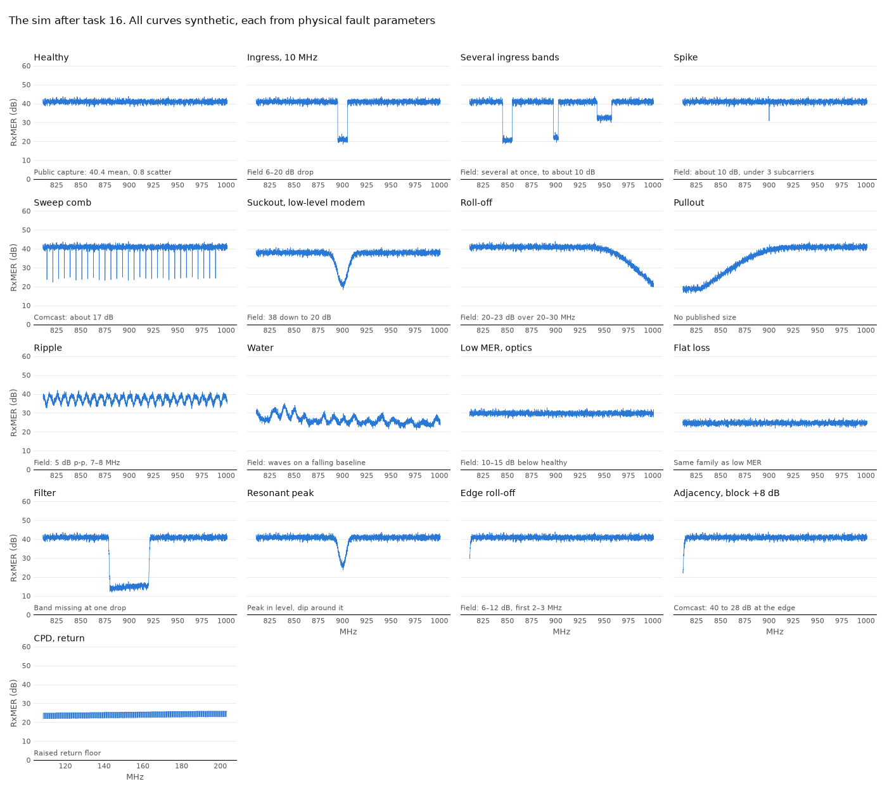

# RxMER gallery

What the sim draws for each impairment CableLabs lists, from physical fault parameters. All curves are **synthetic**, from the invented `fixtures/one_street` plant. Field targets are readings by eye from published captures, listed in `reference/rxmer-impairments.md` §2. Passing says the sim can reach these shapes and sizes, not that its mix of faults matches any real network.

Regenerate the curves with `GALLERY_OUT=path cargo test -p sim --test field_shapes gallery`.

## Results, 2026-11-04

All from `crates/sim/tests/field_shapes.rs`. Every family passes.

| Impairment | Fault used | Target | Sim |
|---|---|---|---|
| Healthy | None | Scatter 0.79 ±0.15, mean 40–47 | 0.80, mean 40.9 |
| Ingress, 10 MHz | +4.5, +8.5, +18.5 dBmV at entry | Drops of 6, 10, 20 ±3, width 10 ±3 | 7.0, 10.5, 20.1, width 10.05 |
| Several bands | Three at once | 20 and 10 ±3 | 20.4 and 8.5 |
| Spike | 0.09 MHz, −12 dBmV | About 10 ±3, under 3 subcarriers | 10.3, 2 subcarriers |
| Sweep comb | 30 narrow carriers, 6 MHz apart | About 17 ±3 | 17.1 |
| Suckout | 16, 20, 32 dB of level, modem 14 dB low | Drops of 13, 18, 30 ±3 | 13.3, 17.2, 29.2 |
| Roll-off | 34 dB, 70 MHz skirt | 21.5 ±4, under 2 dB per MHz | 20.0, 1.54 dB per MHz |
| Pullout | 36 dB, 100 MHz skirt | Low end falls, transmit rises | 22.2 dB at the low end |
| Filter | 40 dB band-stop on one drop | Band gone on that drop only | 26.1 dB inside, others unaffected |
| Ripple | Two reflectors of 3.5 dB return loss, 57 ft apart, modem 15 dB low | 5 ±2 p-p, period 7.5 ±1.5 | 5.2 p-p, period 7.6, 64 % in one period |
| Ripple hidden | The same with weak optics | Flat | 1.05 p-p |
| Water | 40 dB per 100 ft over 70 ft of drop, 70 % impedance variation | 5 ±2.5 p-p, falling 10+, no dominant period | 5.3 p-p, falls 14.6, 20 % in one period |
| Low MER | Optics 18 dB worse | 12.5 ±3, all modems | 11.2, 11.2 |
| Flat loss | 30 dB on a drop | Flat fall, transmit rises | 16.3 |
| Tilt | 15 dB, on a modem low in its window | Only if excessive | 1.6 dB of slope, 0.3 at 3 dB of tilt |
| Resonant peak | 17 dB | 17 ±1.5 in level, dip in RxMER | 17.0, dip of 14.4 |
| Edge roll-off | Ncp 192, Nrp 128, SC-QAM 1 MHz off | 9 ±6, gone at Ncp 1024, Nrp 256 | 10.5, gone |
| Adjacency | Block +8 dB | Block up 8, neighbour's edge falls | 8.0, edge 30.8 to 23.2 |
| Compression | Onset 14 dB under the output | Flat fall | 9.4 |
| Phase distortion | The roll-off | Group delay rises | 26.7 to 45.1 ns |
| CPD | −22 dBmV per MHz | Raised return floor, downstream untouched | 54.1 to 25.0 dB, across the channel |
| Return ingress | VHF channel 8 at +15 dBmV, then as bursts | A dip there, bursts milder | Dip 54.5, bursts 34.5 |

## Not reproduced

- **Hum, a laser's histogram signature and a constellation's compression pattern.** The sim has no such observation yet, so they wait for a new observation version.
- **Second-order distortion against the carriers that cause it.** ZHU2020 says detecting it needs correlating with the sent signal. Here it's noise that moves RxMER, as compression.

## Limits

- Water, ripple and the deepest suckouts need parts or levels at the bad end of what's defensible, chosen by us to reach the field's numbers.
- The sizes come from one short street. No field number is a fit.
- These faults aren't in training yet. That's task 17.
